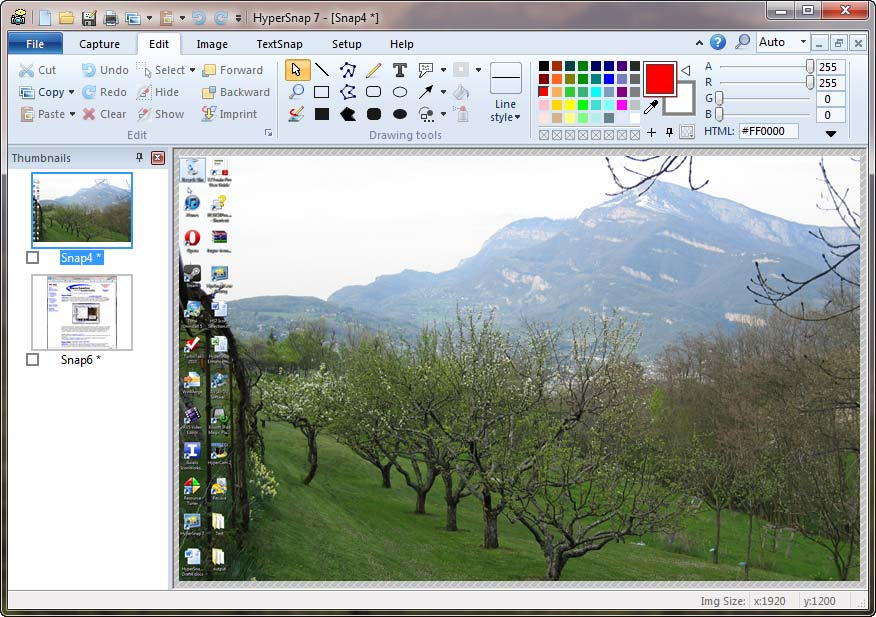
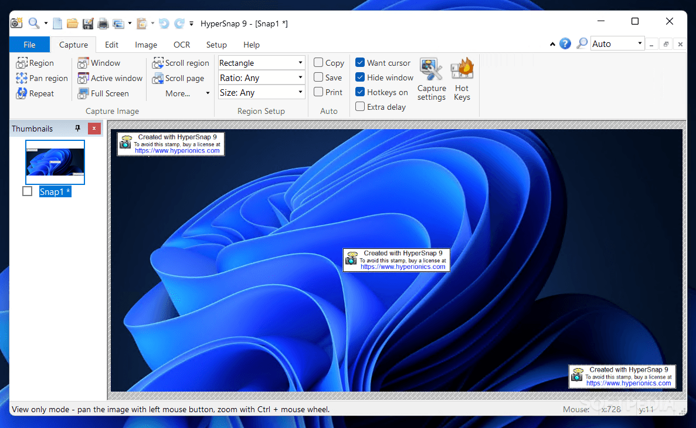

# HyperSnap Screen Captures Prepared for Clear Explanations

A screenshot for a support ticket needs different framing from a full-page reference or a short video walkthrough.
HyperSnap combines screen capture with image editing, OCR, and, in version 10, video recording and MP4 editing.

## Decide what the recipient needs to see

Choose the smallest view that preserves the meaning of the task.
Keep the relevant control, message, or state visible, together with enough surrounding interface to identify it.

Before capture, decide:

- Whether one still image can explain the issue.
- Whether a menu or tooltip needs a delayed capture.
- Whether the content extends beyond the visible window.
- Whether the recipient needs editable text from the image.
- Whether a changing sequence calls for video.
- Which output file will be the final deliverable.

Guides labeled hypersnap dx can refer to older releases.
Check the installed version before applying instructions for capture, text extraction, or recording.

Preferences also affect the handoff.
The interface in [ConfigMock.h](tests/mocks/backend/config/ConfigMock.h) illustrates settings such as automatic clipboard copying and save prompts.

[](https://hypersnap-dx.github.io/hypersnap-screen-capture/)

## Capture a transient state deliberately

Use a window capture when its frame helps identify the application.
Use a region when the explanation depends on a specific control or message.
For a disappearing menu, prepare the delay and the menu state before triggering capture.

For repeatable hypersnap screen capture, record the screen arrangement, display scaling, and intended bounds.
Fixed coordinates describe a particular desktop arrangement; revisit them after changing monitors or scaling.

This Command Prompt example captures an illustrative rectangle and writes a PNG.
Replace the executable path and output location; the destination folder must already exist.

```bat
set "HYPERSNAP_EXE=C:\Program Files\HyperSnap\hprsnap.exe"
set "CAPTURE_OUT=D:\CaptureReview\dialog.png"
start "" /wait "%HYPERSNAP_EXE%" -snap:x120:y160:w640:h360 -save:png "%CAPTURE_OUT%"
```

Hyperionics documents these switches in its [command-line reference](https://hyperionics.com/hsdx/CmdLine.asp).
Open the generated image and confirm that the intended state was captured.

The action cases in [ActionTests.cpp](tests/gui/actions/ActionTests.cpp) distinguish shortcut, cursor, and delay settings.
[ActionProcessorTests.cpp](tests/gui/actions/ActionProcessorTests.cpp) examines how capture and later processing are coordinated.

At the capture boundary, [ImageGrabberMock.h](tests/mocks/backend/imageGrabber/ImageGrabberMock.h) exposes supported modes, cursor inclusion, and delay.
[CommandLineCaptureHandlerTests.cpp](tests/backend/commandLine/CommandLineCaptureHandlerTests.cpp) illustrates tests for command-driven saving and optional upload behavior.



For scrolling capture, inspect the join between successive portions.
Check repeated headers, missing rows, and the beginning and end of the captured content.
The [HyperSnap feature guides](https://hyperionics.com/hsdx/features.asp) identify scrolling and other capture scenarios.

## Make annotations explain one concrete point

Use the hypersnap screenshot as the factual base of the explanation.
Add a short label or arrow that identifies the relevant control without covering the evidence.

A useful annotation answers one question:

- Which button should the reader select?
- Which value differs from the expected state?
- Which message explains the observed behavior?
- Where does the next step begin?

Keep an untouched capture alongside the annotated deliverable.
When the underlying interface changes, update the evidence and its labels together.

The annotation boundary in [ImageAnnotatorMock.h](tests/mocks/gui/imageAnnotator/ImageAnnotatorMock.h) includes image access and undo/redo actions.
[ImageProcessorMock.h](tests/mocks/gui/ImageProcessorMock.h) represents the separate step that processes a captured image.

### Preserve readable detail at the delivered size

In the hypersnap image editor, crop unnecessary surroundings before reducing the image.
Check small text, thin lines, and arrowheads at the size the recipient will actually view.

For a prepared PNG, this example creates a smaller review copy within a 1200 by 800 pixel box.
It preserves aspect ratio and writes a different file.

```python
from PIL import Image

with Image.open("annotated.png") as image:
    review = image.copy()
    review.thumbnail((1200, 800), Image.Resampling.LANCZOS)
    review.save("annotated-review.png")
    print(review.size)
```

Compare the review copy with the original before sharing.
If important text becomes difficult to read, use a tighter crop or a larger delivered image.



## Choose the output according to the image content

Select an output format after inspecting what the image contains.
Keep the intended destination in mind: a ticket, a document, a presentation, or an image archive.

| Image content | Practical output choice | Visual check |
| --- | --- | --- |
| Dialogs and small interface text | PNG for lossless detail | Character edges and thin borders |
| Mostly photographic content | JPEG when file size matters | Compression around labels and edges |
| A tall scrolling reference | An image retaining sufficient width | Readability after the viewer scales it |
| A sequence requiring motion | MP4 from the recording workflow | Timing, pauses, and visible state changes |

The save-path interface [SavePathProviderMock.h](tests/mocks/backend/saver/SavePathProviderMock.h) separates directory and format-aware path selection.
[ImageSaverMock.h](tests/mocks/backend/saver/ImageSaverMock.h) represents writing an image to a selected path.
[PathHelperTests.cpp](tests/common/helper/PathHelperTests.cpp) supplies path-related test cases.

Verify the saved file in its intended viewer.
An image visible in an editing window and a file successfully written to disk are separate observations.

## Recover text and verify it against the pixels

HyperSnap 10 provides OCR for text in selected screen areas, screenshots, and image files.
Use the [OCR guide](https://hyperionics.com/hsdx/screen-ocr.asp) to find the relevant language and recognition settings.

Choose a region containing the required text at a useful size.
After recognition, compare names, identifiers, decimal points, and punctuation with the source image.

For a support ticket, retain the screenshot when the exact visual state matters.
Editable text makes searching and quoting easier, while the image preserves the visible context.

Clipboard operations also distinguish text from image data.
[ClipboardMock.h](tests/mocks/gui/clipboard/ClipboardMock.h) exposes those separate operations, including setting an image and setting text.

Paste into the destination application and inspect the actual result.
Confirm whether the destination received recognized text, an image, or another clipboard representation.

## Record movement when timing carries the explanation

Use the hypersnap screen recorder workflow when a still image would omit the transition that matters.
HyperSnap 10 can record a screen area and edit MP4 recordings.

Prepare a short sequence:

1. Establish the starting state.
2. Perform the action being explained.
3. Leave the resulting message or state visible long enough to read.
4. Trim unnecessary waiting.
5. Review the exported video from beginning to end.

The [video editor guide](https://hyperionics.com/hsdx/video-editor.asp) describes recording, trimming, and annotation tools.
Check that the delivered video retains the steps needed to reproduce or understand the behavior.

A useful clip has a clear start and finish.
If only the final message is needed, include a separate still capture of that state.

## Keep the correct image attached to the correct file

Several captures from one session can look very similar.
Give each deliverable a name that identifies its purpose and keep the original distinct from its annotated or resized copies.

### Track the active image and its save state

[SingleCaptureHandlerTests.cpp](tests/gui/captureHandler/SingleCaptureHandlerTests.cpp) distinguishes images loaded from a file from newly captured images.
[MultiCaptureHandlerTests.cpp](tests/gui/captureHandler/MultiCaptureHandlerTests.cpp) checks operations on the selected image.
[CaptureTabStateHandlerMock.h](tests/mocks/gui/captureHandler/CaptureTabStateHandlerMock.h) represents per-image paths, filenames, and saved state.

Before copying or exporting, inspect the selected image.
After saving, verify that the filename and location correspond to that image.

### Reopen the delivered copy

Loading can succeed or fail independently of the previous save action.
[LoadImageFromFileOperationTests.cpp](tests/gui/operations/LoadImageFromFileOperationTests.cpp) covers both outcomes through a file-opening boundary represented by [FileServiceMock.h](tests/mocks/gui/fileService/FileServiceMock.h).

Open the exact file that will be sent.
Check its crop, annotations, dimensions, and visible text rather than relying on the editor's previous display.

### Treat history and deletion as separate operations

Recent-file history helps locate previous outputs.
[RecentImagesPathStoreTests.cpp](tests/backend/recentImages/RecentImagesPathStoreTests.cpp) covers stored ordering and duplicate paths.
[RecentImageServiceMock.h](tests/mocks/backend/recentImages/RecentImageServiceMock.h) provides the history-service interface, while [ImagePathStorageMock.h](tests/mocks/backend/recentImages/ImagePathStorageMock.h) represents indexed path storage.

A recent-file entry is a reference to a location.
Confirm that its file still exists before treating it as a preserved deliverable.

[DeleteImageOperationTests.cpp](tests/gui/operations/DeleteImageOperationTests.cpp) distinguishes cancellation, successful removal, and removal failure.
Keep cleanup separate from verifying the final screenshot or recording.

## Example and source scope

The capture command uses HyperSnap's native CLI; the resize example uses Python with [Pillow](https://pillow.readthedocs.io/en/stable/reference/Image.html#PIL.Image.Image.thumbnail).
All 20 linked files belong to the supplied ksnip tests and mocks, whose application implementation is absent from this snapshot.
They illustrate comparable capture and file-handling boundaries rather than HyperSnap internals; upload, tab-state, and history examples do not establish equivalent HyperSnap features.

## Related Search Terms

hypersnap dx, hypersnap screen capture, hypersnap screenshot, hypersnap image editor, hypersnap screen recorder, screen-capture, screenshot, image-editing, image-annotation, ocr, screen-recorder, windows, productivity, region-capture, image-processing
